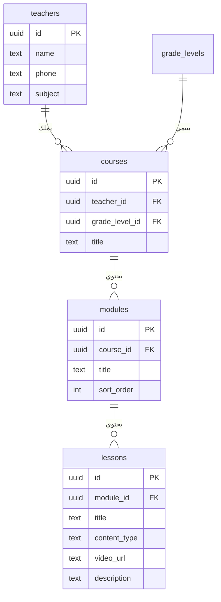
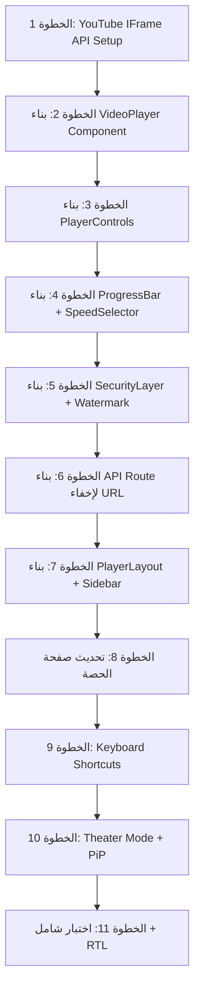
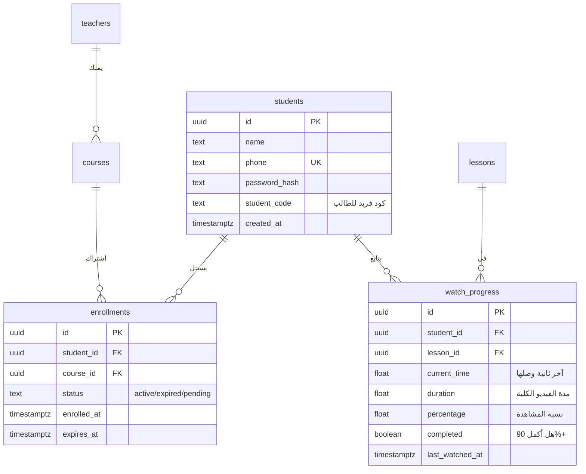
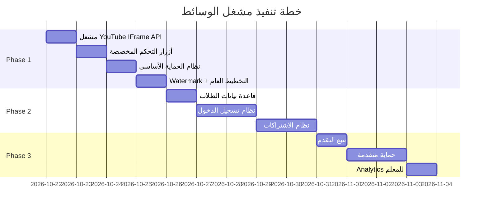

# 🎬 خطة تنفيذ مشغل الوسائط الاحترافي — منصة دروس

> **تاريخ الإنشاء:** 2026-10-21
> **الحالة:** في انتظار الموافقة

---

## 📋 ملخص المشروع

بناء مشغل وسائط احترافي ومؤمّن بالكامل يسمح للطلاب المشتركين فقط بمشاهدة الحصص الدراسية التي يرفعها المعلم عبر روابط YouTube، مع منظومة حماية متعددة الطبقات لمنع سرقة المحتوى وتتبع تقدم الطالب.

---

## 🏗️ الوضع الحالي للمشروع (Current State)

### ما هو موجود حالياً:

| المكوّن | الحالة | الملاحظات |
|---|---|---|
| [StudentLessonPlayer.tsx](file:///e:/Droos%20App/droos-app/components/student/StudentLessonPlayer.tsx) | ✅ موجود — أساسي | يعرض YouTube iframe أو `<video>` مع playlist جانبية + breadcrumb + tabs |
| [lesson/[lessonId]/page.tsx](file:///e:/Droos%20App/droos-app/app/p/%5Bslug%5D/lesson/%5BlessonId%5D/page.tsx) | ✅ موجود | Server Component يجلب بيانات الحصة من Supabase |
| [public-platform.ts](file:///e:/Droos%20App/droos-app/lib/queries/public-platform.ts) → `getPublicLesson()` | ✅ موجود | يجلب الحصة + الحصص المجاورة (playlist) |
| [LessonRow.tsx](file:///e:/Droos%20App/droos-app/components/teacher/droos/LessonRow.tsx) | ✅ موجود | المعلم يدخل `video_url` يدوياً |
| نظام تسجيل الطالب / الاشتراكات | ❌ غير موجود | لا يوجد auth للطالب ولا نظام مجموعات |
| حماية المحتوى | ❌ غير موجود | أي شخص يعرف الرابط يشاهد الفيديو |
| تتبع التقدم (Progress) | ❌ غير موجود | لا يوجد حفظ آخر موضع أو نسبة المشاهدة |
| مشغل فيديو مخصص | ❌ غير موجود | يستخدم YouTube iframe العادي |

### بنية قاعدة البيانات الحالية:



---

## 🎯 المراحل (Phases)

---

## Phase 1 — المشغل الاحترافي + الحماية الأساسية

> **الهدف:** تحويل المشغل الحالي من YouTube iframe بسيط إلى مشغل احترافي متقدم مع حماية أساسية للمحتوى
> **المدة المتوقعة:** 3-4 جلسات عمل

### 1.1 مشغل الفيديو الاحترافي (Custom Video Player)

#### ما سنبنيه:

```
┌──────────────────────────────────────────────────────────────────┐
│  ┌─────────────────────────────────────────────────────────┐     │
│  │                                                         │     │
│  │                    🎬 VIDEO AREA                        │     │
│  │           YouTube Embed (privacy-enhanced)              │     │
│  │                                                         │     │
│  │          ┌───────────────────────────────┐              │     │
│  │          │   🔒 هذا المحتوى محمي        │              │     │
│  │          │   Watermark: اسم الطالب       │              │     │
│  │          └───────────────────────────────┘              │     │
│  │                                                         │     │
│  ├─────────────────────────────────────────────────────────┤     │
│  │ ▶ advancement bar ████████░░░░░░░ 45:20 / 1:30:00     │     │
│  │ 🔊 Vol  | 0.5x 1x ▸1.5x 2x | 🖥️ Theater | ⛶ Full   │     │
│  └─────────────────────────────────────────────────────────┘     │
│                                                                  │
│  ┌─ الحصة الحالية ──────────┐  ┌─ قائمة الحصص ─────────────┐   │
│  │                           │  │                             │   │
│  │  📌 الوحدة: التفاضل       │  │  ① الحصة 1: مفهوم... ▶ 🟢  │   │
│  │  📖 الحصة 2: تمارين...    │  │  ② ▶ الحصة 2: تمارين  🔵   │   │
│  │                           │  │  ③ الحصة 3: اختبار    ⚪   │   │
│  │  ← السابقة | التالية →   │  │  ④ الحصة 4: مراجعة    ⚪   │   │
│  │                           │  │                             │   │
│  │  [شرح وملاحظات] [PDF]    │  │                             │   │
│  └───────────────────────────┘  └─────────────────────────────┘   │
└──────────────────────────────────────────────────────────────────┘
```

#### مكونات المشغل:

| المكون | الوصف | التقنية |
|---|---|---|
| `VideoPlayer` | المشغل الرئيسي | YouTube IFrame API (JavaScript API — **ليس** مجرد iframe) |
| `PlayerControls` | أزرار التحكم المخصصة | React + CSS animations |
| `ProgressBar` | شريط التقدم التفاعلي | Custom slider مع Seek |
| `SpeedSelector` | اختيار سرعة التشغيل | `0.5x` → `0.75x` → `1x` → `1.25x` → `1.5x` → `2x` |
| `VolumeControl` | التحكم في الصوت | Slider + Mute toggle |
| `FullscreenToggle` | ملء الشاشة | Fullscreen API |
| `TheaterMode` | وضع المسرح (عرض كامل) | CSS layout toggle |
| `MiniPlayer` | صورة داخل صورة | Picture-in-Picture API |
| `QualitySelector` | اختيار الجودة | YouTube API `.setPlaybackQuality()` |
| `KeyboardShortcuts` | اختصارات لوحة المفاتيح | `Space` → play/pause, `→/←` → seek 10s, `↑/↓` → volume |
| `Watermark` | العلامة المائية | CSS overlay مع اسم الطالب + رقم الكود |

#### لماذا YouTube IFrame API وليس iframe عادي؟

> [!IMPORTANT]
> حالياً المشغل يستخدم `<iframe src="youtube-nocookie.com/embed/...">` — هذا لا يسمح بأي تحكم.
> **YouTube IFrame API** يعطينا:
> - التحكم في Play/Pause/Seek برمجياً
> - معرفة الوقت الحالي (`getCurrentTime()`) → لحفظ آخر موضع
> - معرفة مدة الفيديو (`getDuration()`) → لحساب نسبة المشاهدة
> - التحكم في الجودة والسرعة
> - إخفاء controls الأصلية لعرض controls مخصصة
> - اعتراض أحداث مثل `onStateChange` للأمان

#### اختصارات لوحة المفاتيح:

| المفتاح | الوظيفة |
|---|---|
| `Space` / `K` | تشغيل / إيقاف |
| `→` | تقديم 10 ثواني |
| `←` | ترجيع 10 ثواني |
| `↑` | رفع الصوت 5% |
| `↓` | خفض الصوت 5% |
| `M` | كتم الصوت |
| `F` | ملء الشاشة |
| `T` | وضع المسرح |
| `>` | تسريع |
| `<` | تبطيء |

---

### 1.2 نظام حماية المحتوى — الطبقة الأولى (Client-Side Protection)

> [!WARNING]
> **حقيقة مهمة يجب فهمها:** لا يوجد حل يمنع تسجيل الشاشة بنسبة 100%. حتى Netflix و Disney+ لا يستطيعان منعها تماماً.
> ما نستطيع فعله هو جعل السرقة **صعبة جداً** و**غير مربحة** و**قابلة للتتبع**.

#### ما سننفذه في Phase 1:

| الحماية | كيف تعمل | مستوى الحماية |
|---|---|---|
| **Watermark ديناميكي** | عرض اسم الطالب + كود فريد فوق الفيديو بشكل شبه شفاف يتحرك عشوائياً | 🛡️🛡️🛡️ **ممتاز** — أي تسجيل شاشة سيحتوي على هوية الطالب |
| **منع Right-click** | `contextmenu` event prevention | 🛡️ بسيط — يمنع المبتدئين |
| **منع DevTools** | كشف فتح أدوات المطور + تعطيل `F12`, `Ctrl+Shift+I` | 🛡️🛡️ متوسط |
| **منع التحديد والنسخ** | `user-select: none` + `dragstart` prevention | 🛡️ بسيط |
| **CSS Overlay** | طبقة شفافة فوق الفيديو تمنع الوصول المباشر للـ iframe | 🛡️🛡️ متوسط |
| **Blur on Tab Switch** | تشويش الفيديو عند مغادرة التبويب (يمنع تسجيل الشاشة من تطبيقات أخرى) | 🛡️🛡️ جيد |
| **كشف تسجيل الشاشة** | `navigator.mediaDevices.getDisplayMedia` API check + Screen Capture API detection | 🛡️🛡️ جيد |
| **إخفاء URL الفيديو** | عدم تمرير رابط YouTube المباشر للـ client — تمريره عبر API route مع session check | 🛡️🛡️🛡️ ممتاز |

#### تفصيل الـ Watermark الديناميكي:

```
┌─────────────────────────────────────────────┐
│                                             │
│    ┌─────────────────────────┐              │
│    │ 🎬 فيديو الحصة         │              │
│    │                         │              │
│    │     أحمد محمد - 4K82    │  ← يتحرك    │
│    │                         │     عشوائياً │
│    │                         │     كل 30 ثانية
│    │                         │              │
│    └─────────────────────────┘              │
│                                             │
└─────────────────────────────────────────────┘
```

- **اسم الطالب** + **كود مكون من 4 أحرف فريد**
- **شفافية**: `opacity: 0.15` — مرئي في تسجيل الشاشة لكن لا يزعج المشاهد
- **موقع عشوائي**: يتحرك كل 30 ثانية إلى موقع مختلف
- **خط**: نفس خط المنصة بحجم صغير
- **لا يمكن إزالته**: ليس عنصر DOM عادي — يُرسم عبر Canvas overlay أو CSS pointer-events

---

### 1.3 الملفات والمكونات المطلوبة (Phase 1)

```
components/
  student/
    media-player/
      VideoPlayer.tsx              ← المشغل الرئيسي (YouTube IFrame API)
      PlayerControls.tsx           ← أزرار التحكم المخصصة
      ProgressBar.tsx              ← شريط التقدم
      SpeedSelector.tsx            ← اختيار السرعة
      VolumeControl.tsx            ← التحكم في الصوت
      TheaterMode.tsx              ← وضع المسرح
      Watermark.tsx                ← العلامة المائية الديناميكية
      SecurityLayer.tsx            ← طبقة الحماية (DevTools + right-click + blur)
      PlayerSidebar.tsx            ← القائمة الجانبية (playlist)
      PlayerLayout.tsx             ← التخطيط العام للصفحة
      types.ts                     ← TypeScript interfaces
      hooks/
        useYouTubePlayer.ts        ← Hook للتعامل مع YouTube IFrame API
        usePlayerState.ts          ← إدارة حالة المشغل (playing, time, volume, etc.)
        useKeyboardShortcuts.ts    ← اختصارات لوحة المفاتيح
        useSecurityGuard.ts        ← Hook الحماية (DevTools detection, blur, etc.)
        useWatermark.ts            ← Hook العلامة المائية المتحركة

app/
  api/
    lesson/
      [lessonId]/
        video-url/
          route.ts                 ← API Route يعطي رابط YouTube بعد التحقق من الاشتراك

  p/
    [slug]/
      lesson/
        [lessonId]/
          page.tsx                 ← تحديث الصفحة لاستخدام المشغل الجديد
```

---

### 1.4 خطوات التنفيذ (Phase 1)



| # | الخطوة | التفاصيل | الملفات |
|---|---|---|---|
| 1 | YouTube IFrame API Setup | تحميل API script ديناميكياً + Hook `useYouTubePlayer` | `useYouTubePlayer.ts` |
| 2 | VideoPlayer Component | المشغل الأساسي مع YouTube API integration | `VideoPlayer.tsx` |
| 3 | PlayerControls | Play/Pause, Seek ±10s, Volume, Mute | `PlayerControls.tsx`, `VolumeControl.tsx` |
| 4 | ProgressBar + Speed | شريط تقدم تفاعلي + اختيار السرعة | `ProgressBar.tsx`, `SpeedSelector.tsx` |
| 5 | SecurityLayer + Watermark | حماية كاملة: DevTools + Right-click + Blur + Watermark | `SecurityLayer.tsx`, `Watermark.tsx`, `useSecurityGuard.ts` |
| 6 | API Route | إخفاء رابط YouTube — يمرر فقط Video ID بعد التحقق | `api/lesson/[lessonId]/video-url/route.ts` |
| 7 | PlayerLayout + Sidebar | التخطيط الكامل مع القائمة الجانبية + Tabs | `PlayerLayout.tsx`, `PlayerSidebar.tsx` |
| 8 | تحديث الصفحة | ربط كل المكونات في صفحة الحصة | `lesson/[lessonId]/page.tsx` |
| 9 | Keyboard Shortcuts | جميع الاختصارات المذكورة أعلاه | `useKeyboardShortcuts.ts` |
| 10 | Theater + PiP | وضع المسرح + صورة داخل صورة | `TheaterMode.tsx` |
| 11 | اختبار | RTL + Responsive + أمان + أداء | — |

---

## Phase 2 — نظام تسجيل الطالب والاشتراكات (Auth + Access Control)

> **الهدف:** الطالب لازم يكون مسجل ومشترك في المجموعة عشان يشوف الفيديو
> **المدة المتوقعة:** 3-4 جلسات عمل

### 2.1 قاعدة البيانات الجديدة



### 2.2 نظام تسجيل دخول الطالب

| المكون | التفاصيل |
|---|---|
| **تسجيل الدخول** | رقم الموبايل + كلمة المرور |
| **إنشاء حساب** | رقم الموبايل + اسم + كلمة المرور (بدون تأكيد بريد) |
| **الجلسة** | Cookie-based session عبر Supabase Auth أو JWT مخصص |
| **Middleware** | حماية مسار `/p/[slug]/lesson/*` — redirect لصفحة تسجيل الدخول |

### 2.3 نظام الاشتراكات / المجموعات

| الميزة | التفاصيل |
|---|---|
| المعلم يضيف طلاب | من لوحة التحكم — يدخل أرقام موبايلات الطلاب |
| صلاحية الاشتراك | مدة محددة (شهر/ترم/سنة) أو دائم |
| حالة الاشتراك | `active` → يشاهد، `expired` → يشوف القفل، `pending` → في الانتظار |
| قفل المحتوى | الطالب الغير مشترك يشوف عنوان الحصة + وصف لكن الفيديو مقفول |

---

## Phase 3 — تتبع التقدم + Analytics + حماية متقدمة

> **الهدف:** حفظ آخر موضع + نسبة المشاهدة + حماية متقدمة ضد تسجيل الشاشة
> **المدة المتوقعة:** 2-3 جلسات عمل

### 3.1 تتبع التقدم (Progress Tracking)

```
[الطالب يشاهد الفيديو]
        ↓
[كل 10 ثواني → POST /api/progress]
        ↓
[حفظ في watch_progress]
        ↓
[عند العودة → استرجاع آخر موضع]
        ↓
[عرض شريط تقدم أخضر في playlist]
```

| الميزة | التفاصيل |
|---|---|
| **حفظ آخر موضع** | كل 10 ثواني يرسل `currentTime` للسيرفر |
| **استكمال المشاهدة** | عند فتح الحصة مرة ثانية → يبدأ من آخر موضع |
| **نسبة الإكمال** | شريط أخضر صغير تحت كل حصة في الـ playlist |
| **علامة الإكمال** | إذا شاهد 90%+ → ✅ مكتمل |
| **لوحة المعلم** | المعلم يشوف نسبة مشاهدة كل طالب |

### 3.2 حماية متقدمة (Advanced Security)

| الحماية | التفاصيل |
|---|---|
| **Session لكل جهاز** | الطالب يسجل من جهاز واحد فقط — لو سجل من جهاز ثاني ينفصل الأول |
| **Token-based video URL** | رابط الفيديو يتغير كل 5 دقائق |
| **Activity heartbeat** | كل 30 ثانية → ping للسيرفر — لو انقطع = شخص حاول التلاعب |
| **IP/Device fingerprint** | تسجيل بصمة الجهاز لكشف المشاركة |
| **Rate limiting** | منع مشاهدة أكثر من 3 حصص في نفس الوقت |
| **تسجيل المخالفات** | لوحة للمعلم تعرض محاولات التسجيل/السرقة |

---

## 📊 ملخص المراحل



---

## ⚙️ القرارات التقنية

### لماذا YouTube IFrame API وليس Video.js أو Plyr؟

| الخيار | المميزات | العيوب | القرار |
|---|---|---|---|
| **YouTube IFrame API** | مجاني، CDN سريع، لا تخزين، المعلم يرفع على YouTube مباشرة | تحكم محدود في بعض الأشياء (مثل إخفاء logo YouTube) | ✅ **اخترناه** |
| Video.js / Plyr | تحكم كامل 100% | يحتاج استضافة فيديو + تكلفة bandwidth عالية | ❌ |
| Bunny Stream | DRM كامل + حماية قوية | تكلفة شهرية + إعداد معقد | ❌ ليس الآن |

### المكتبات المطلوبة

> [!NOTE]
> **لا نحتاج أي مكتبات خارجية جديدة في Phase 1!**
> كل شيء سيبنى بـ React + CSS + YouTube IFrame API (مجاني من Google).

| المكتبة | الغرض | Phase |
|---|---|---|
| YouTube IFrame API (CDN script) | التحكم في YouTube player | Phase 1 |
| — لا شيء إضافي — | — | Phase 1 |
| bcryptjs (موجود أصلاً) | تشفير كلمة مرور الطالب | Phase 2 |

---

## 🎨 التصميم المرئي

### المبادئ:

1. **Premium Feel** — تصميم يشبه Coursera / Udemy Pro / Netflix
2. **RTL Native** — كل العناصر RTL بدون أي استثناء
3. **الثيم الموحد** — يستخدم ألوان المنصة (`primary-500: #1F7A7B`, `accent-500: #E8A83C`)
4. **Dark Video Area** — منطقة الفيديو دائماً داكنة (كالسينما)
5. **Controls تظهر عند Hover** — مثل YouTube الحقيقي
6. **Responsive** — يعمل على موبايل 320px وحتى 4K

### حالات المشغل:

| الحالة | ما يظهر |
|---|---|
| Loading | Skeleton + spinner |
| Playing | الفيديو + controls شبه مخفية |
| Paused | الفيديو + controls ظاهرة + زر Play كبير في المنتصف |
| Error | رسالة خطأ عربية واضحة + زر إعادة المحاولة |
| Locked (Phase 2) | Blurred thumbnail + قفل + "اشترك لمشاهدة هذه الحصة" |
| Completed | ✅ + "أحسنت! الحصة التالية" |
| No Video URL | رسالة "لم يتم رفع فيديو لهذه الحصة بعد" |

---

## 🛡️ ملخص طبقات الحماية

```
┌─────────────────────────────────────────────────────────────┐
│                    طبقات الحماية                            │
├─────────────────────────────────────────────────────────────┤
│                                                             │
│  Layer 1 (Phase 1): Client-Side                            │
│  ├── Watermark ديناميكي (اسم الطالب + كود)                │
│  ├── منع Right-click                                       │
│  ├── كشف DevTools                                          │
│  ├── Blur on Tab Switch                                    │
│  ├── CSS Overlay (منع الوصول للـ iframe)                   │
│  ├── إخفاء URL الفيديو عبر API Route                       │
│  └── منع التحديد والنسخ                                    │
│                                                             │
│  Layer 2 (Phase 2): Server-Side                            │
│  ├── Auth check (الطالب مسجل)                              │
│  ├── Enrollment check (الطالب مشترك)                       │
│  └── Session validation                                     │
│                                                             │
│  Layer 3 (Phase 3): Advanced                               │
│  ├── Single device session                                  │
│  ├── Token rotation (كل 5 دقائق)                           │
│  ├── Activity heartbeat                                     │
│  ├── Device fingerprint                                     │
│  └── مخالفات logging                                        │
│                                                             │
└─────────────────────────────────────────────────────────────┘
```

---

## ✅ معايير القبول (Phase 1)

- [ ] المشغل يعمل مع روابط YouTube بشكل مثالي
- [ ] Controls مخصصة: Play/Pause, Seek, Volume, Speed, Fullscreen
- [ ] Theater Mode يعمل
- [ ] Keyboard shortcuts تعمل
- [ ] Watermark ديناميكي يظهر (مؤقتاً باسم "طالب تجريبي" حتى Phase 2)
- [ ] منع Right-click
- [ ] كشف DevTools
- [ ] Blur on Tab Switch
- [ ] URL الفيديو مخفي عن الـ client
- [ ] Responsive: 320px → 1920px
- [ ] RTL كامل
- [ ] Playlist جانبية تعمل
- [ ] التنقل بين الحصص (السابقة/التالية)
- [ ] Tabs: شرح الدرس + PDF
- [ ] Breadcrumb navigation
- [ ] لا أخطاء في Console
- [ ] أداء ممتاز (لا lag أو جودة منخفضة)

---

> [!TIP]
> **التوصية:** نبدأ بـ Phase 1 فوراً. بمجرد ما يكون المشغل الاحترافي جاهز ومعمول deploy، ننتقل لـ Phase 2 (نظام الطلاب). Phase 3 يمكن أن يكون تحسين مستمر.

---

## ⏭️ الخطوة التالية

**بعد الموافقة على هذه الخطة:**
1. إنشاء branch جديد: `feature/media-player-phase1`
2. البدء بالخطوة 1: YouTube IFrame API Setup + `useYouTubePlayer` Hook
3. التقدم خطوة بخطوة مع مراجعة كل مكون
